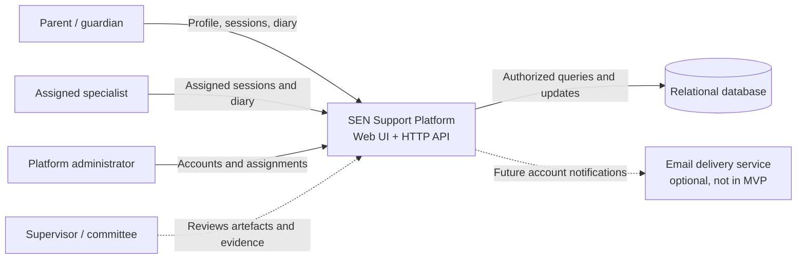
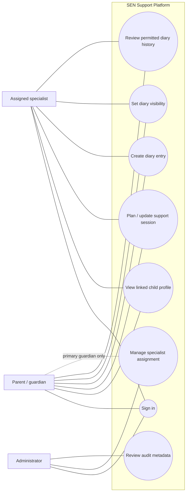
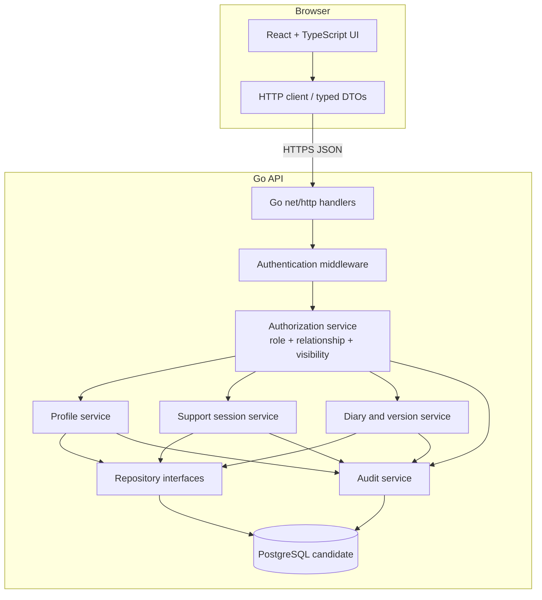
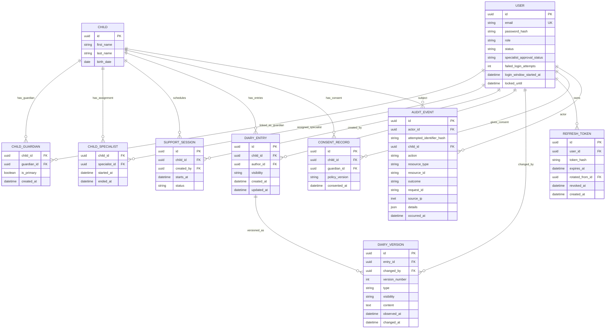

# Architecture and Diagram Set (Draft)

**Status:** Draft for pre-defense 1; diagrams are editable Mermaid source.  
**Consistency rule:** The Mermaid blocks in this document and the linked `.mmd` files are the canonical diagrams. Keep them synchronized and follow the requirements and threat model. Exports in `docs/diagrams/` (SVG/PNG) are generated from these diagrams; if they differ, Mermaid is authoritative. Refresh or remove them after the canonical diagrams are reviewed.

## Architecture summary

The browser UI calls a Go HTTP API. The API authenticates the user, checks role and active relationship for each child-linked resource, applies diary visibility rules, and uses repositories to persist records in a relational database. Audit events are written alongside sensitive operations. The current repository has frontend starter code and draft domain types; API handlers, repositories, migrations, and persistence are not yet implemented.

## 1. System context

## 2. Use cases

Authorization constraint: every child-specific use case requires an active relationship; visibility and role rules are enforced by the API, not merely hidden in the interface.

## 3. Component diagram

## 4. ER diagram

All `datetime` values are stored in UTC. The diagram is a conceptual draft; exact constraints, retention, and migrations need review after the API contract and legal questions are resolved. Diary content is intentionally omitted from audit events.

## Diagram files

The four diagrams above are authored here as Mermaid. The distinct data-flow diagram is maintained in [`diagrams/dfd.mmd`](diagrams/dfd.mmd). Existing SVG and PNG renderings are grouped under [`diagrams/exports/`](diagrams/exports/) and are not editable sources of truth. Regenerate or replace those exports from the reviewed Mermaid diagrams when they are updated.
